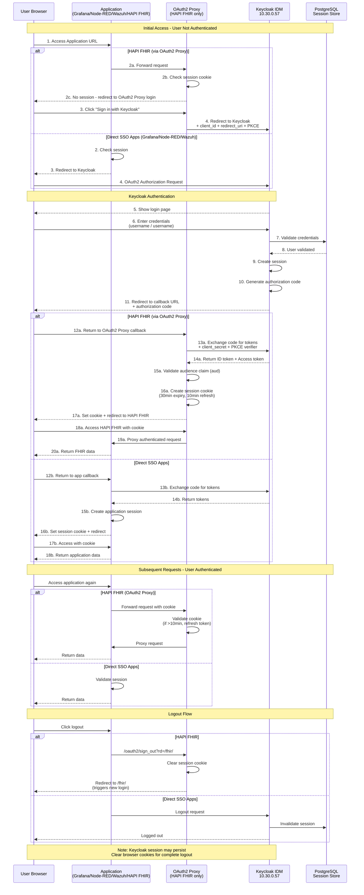
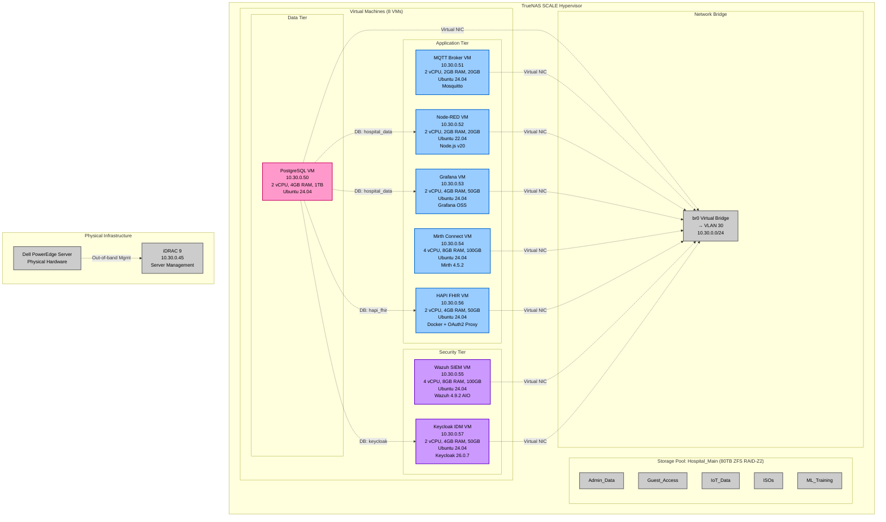
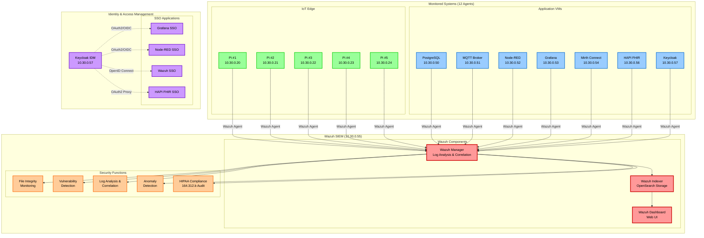

# Hospital Homelab Network - Topology Diagrams

**Created:** January 29, 2026
**Project:** Senior Capstone - Hospital Homelab Network Infrastructure

---

## Table of Contents
1. [Physical Network Topology](#1-physical-network-topology)
2. [Data Flow Architecture](#2-data-flow-architecture)
3. [Authentication Flow (SSO)](#3-authentication-flow-sso)
4. [Virtual Machine Infrastructure](#4-virtual-machine-infrastructure)
5. [Security Monitoring Architecture](#5-security-monitoring-architecture)

---

## 1. Physical Network Topology

### Mermaid Diagram Code

```mermaid
graph TB
    subgraph Internet
        ISP[Internet Service Provider]
    end

    subgraph "Home Network"
        DR7[Dream Router 7<br/>Home ISP Gateway]
    end

    subgraph "VLAN 30 - Hospital Homelab Network<br/>10.30.0.0/24"
        UDM[UniFi Dream Machine SE<br/>10.30.0.1<br/>Gateway/Firewall/DHCP]

        subgraph "Core Infrastructure"
            SWITCH[UniFi Switch Pro Max 24 PoE<br/>10.30.0.10<br/>24 Ports + 2 SFP+]
            TRUENAS[TrueNAS Server<br/>10.30.0.44<br/>80TB Storage]
            IDRAC[iDRAC 9<br/>10.30.0.45<br/>Server Management]
        end

        subgraph "IoT Edge Devices (PoE++)"
            PI1[Raspberry Pi #1<br/>10.30.0.20<br/>72 BPM Normal]
            PI2[Raspberry Pi #2<br/>10.30.0.21<br/>68 BPM Normal]
            PI3[Raspberry Pi #3<br/>10.30.0.22<br/>75 BPM Normal]
            PI4[Raspberry Pi #4<br/>10.30.0.23<br/>110±40 BPM AFib]
            PI5[Raspberry Pi #5<br/>10.30.0.24<br/>70 BPM + Anomalies]
        end

        subgraph "Network Access"
            AP[U6 Pro WiFi AP<br/>10.30.0.246<br/>WiFi 6]
            LAPTOP[Laptop UltraMoad<br/>10.30.0.122<br/>Admin Workstation]
        end

        subgraph "Virtual Machines on TrueNAS"
            POSTGRES[PostgreSQL VM<br/>10.30.0.50<br/>Database Server]
            MQTT[MQTT Broker VM<br/>10.30.0.51<br/>Eclipse Mosquitto]
            NODERED[Node-RED VM<br/>10.30.0.52<br/>Workflow Automation]
            GRAFANA[Grafana VM<br/>10.30.0.53<br/>Analytics Dashboard]
            MIRTH[Mirth Connect VM<br/>10.30.0.54<br/>HL7/FHIR Engine]
            WAZUH[Wazuh SIEM VM<br/>10.30.0.55<br/>Security Monitoring]
            HAPIFHIR[HAPI FHIR VM<br/>10.30.0.56<br/>FHIR R4 Server]
            KEYCLOAK[Keycloak IDM VM<br/>10.30.0.57<br/>Identity Management]
        end
    end

    %% Physical Connections
    ISP -->|WAN| DR7
    DR7 -->|Port 10| UDM
    UDM -->|Port 11 SFP+ 10Gbps| SWITCH
    UDM -->|Port 1| LAPTOP
    UDM -->|Port 3| TRUENAS
    UDM -->|Port 5| IDRAC

    SWITCH -->|Port 9 PoE++| PI1
    SWITCH -->|Port 10 PoE++| PI2
    SWITCH -->|Port 11 PoE++| PI3
    SWITCH -->|Port 12 PoE++| PI4
    SWITCH -->|Port 13 Ext Power| PI5
    SWITCH -->|Port 17 PoE+| AP

    TRUENAS -.->|Virtual Bridge| POSTGRES
    TRUENAS -.->|Virtual Bridge| MQTT
    TRUENAS -.->|Virtual Bridge| NODERED
    TRUENAS -.->|Virtual Bridge| GRAFANA
    TRUENAS -.->|Virtual Bridge| MIRTH
    TRUENAS -.->|Virtual Bridge| WAZUH
    TRUENAS -.->|Virtual Bridge| HAPIFHIR
    TRUENAS -.->|Virtual Bridge| KEYCLOAK

    %% Styling
    classDef gateway fill:#ff9999,stroke:#cc0000,stroke-width:3px,color:#000
    classDef core fill:#99ccff,stroke:#0066cc,stroke-width:2px,color:#000
    classDef iot fill:#99ff99,stroke:#00cc00,stroke-width:2px,color:#000
    classDef vm fill:#ffcc99,stroke:#ff6600,stroke-width:2px,color:#000
    classDef client fill:#cc99ff,stroke:#6600cc,stroke-width:2px,color:#000

    class UDM,DR7 gateway
    class SWITCH,TRUENAS,IDRAC core
    class PI1,PI2,PI3,PI4,PI5 iot
    class POSTGRES,MQTT,NODERED,GRAFANA,MIRTH,WAZUH,HAPIFHIR,KEYCLOAK vm
    class LAPTOP,AP client
```

### How to Render:
1. Copy the code above (including the \`\`\`mermaid tags)
2. Go to https://mermaid.live
3. Paste and export as PNG/SVG

---

## 2. Data Flow Architecture

### Mermaid Diagram Code

```mermaid
graph LR
    subgraph "Edge Layer"
        PI1[Pi #1<br/>72 BPM]
        PI2[Pi #2<br/>68 BPM]
        PI3[Pi #3<br/>75 BPM]
        PI4[Pi #4<br/>110±40 BPM AFib]
        PI5[Pi #5<br/>70 BPM Anomalies]
    end

    subgraph "Message Broker Layer"
        MQTT[MQTT Broker<br/>Eclipse Mosquitto<br/>Port 1883]
    end

    subgraph "Processing Layer"
        NODERED[Node-RED<br/>Workflow Engine]

        subgraph "Node-RED Functions"
            PARSE[JSON Parser]
            ROUTE[Topic Router]
            DASHBOARD[Real-time Dashboard]
            DB_INSERT[PostgreSQL Insert]
            RATE_LIMIT[Rate Limiter<br/>1 msg/sec]
            HTTP_SEND[HTTP POST to Mirth]
        end
    end

    subgraph "Storage Layer"
        POSTGRES[(PostgreSQL<br/>Time-Series DB<br/>397M+ rows)]
    end

    subgraph "Healthcare Layer"
        MIRTH[Mirth Connect<br/>HL7/FHIR Engine]
        HAPIFHIR[HAPI FHIR Server<br/>R4 API + PostgreSQL]
    end

    subgraph "Visualization Layer"
        GRAFANA[Grafana<br/>Historical Analytics]
        DASHBOARD_UI[Node-RED Dashboard<br/>Real-time Monitoring]
    end

    %% Data Flow
    PI1 -->|MQTT Publish<br/>20 Hz| MQTT
    PI2 -->|MQTT Publish<br/>20 Hz| MQTT
    PI3 -->|MQTT Publish<br/>20 Hz| MQTT
    PI4 -->|MQTT Publish<br/>20 Hz| MQTT
    PI5 -->|MQTT Publish<br/>20 Hz| MQTT

    MQTT -->|Subscribe<br/>hospital/heartrate/#| NODERED

    NODERED --> PARSE
    PARSE --> ROUTE
    ROUTE --> DASHBOARD
    ROUTE --> DB_INSERT
    ROUTE --> RATE_LIMIT

    DB_INSERT -->|100 inserts/sec| POSTGRES
    RATE_LIMIT --> HTTP_SEND

    HTTP_SEND -->|HTTP POST<br/>Port 8081| MIRTH
    MIRTH -->|FHIR R4<br/>Transformation| HAPIFHIR

    POSTGRES -->|SQL Queries| GRAFANA

    DASHBOARD -->|WebSocket| DASHBOARD_UI

    %% Styling
    classDef edge fill:#99ff99,stroke:#00cc00,stroke-width:2px,color:#000
    classDef messaging fill:#ffcc99,stroke:#ff6600,stroke-width:2px,color:#000
    classDef processing fill:#99ccff,stroke:#0066cc,stroke-width:2px,color:#000
    classDef storage fill:#ff99cc,stroke:#cc0066,stroke-width:2px,color:#000
    classDef healthcare fill:#cc99ff,stroke:#6600cc,stroke-width:2px,color:#000
    classDef viz fill:#ffff99,stroke:#cccc00,stroke-width:2px,color:#000

    class PI1,PI2,PI3,PI4,PI5 edge
    class MQTT messaging
    class NODERED,PARSE,ROUTE,RATE_LIMIT,HTTP_SEND processing
    class POSTGRES,DB_INSERT storage
    class MIRTH,HAPIFHIR healthcare
    class GRAFANA,DASHBOARD,DASHBOARD_UI viz
```

### Data Rates:
- **Edge to MQTT**: 100 messages/second (5 Pis × 20 Hz)
- **MQTT to Node-RED**: 100 messages/second
- **Node-RED to PostgreSQL**: 100 inserts/second
- **Node-RED to Mirth**: 1 message/second (rate-limited)
- **Mirth to HAPI FHIR**: 1 FHIR Observation/second

---

## 3. Authentication Flow (SSO)

### Mermaid Diagram Code

### Authentication Details:
- **Protocol**: OAuth2 / OpenID Connect (OIDC)
- **PKCE**: Enabled (S256 code challenge method) for HAPI FHIR
- **Session Timeout**: 30 minutes (absolute), 10 minutes (refresh) for HAPI FHIR
- **Keycloak Session**: Configurable (default 30min idle, 1hr max)
- **Integrated Applications**: 4 (Grafana, Node-RED, Wazuh, HAPI FHIR)

---

## 4. Virtual Machine Infrastructure

### Mermaid Diagram Code

### VM Resource Summary:
| VM | vCPU | RAM | Disk | Database |
|----|------|-----|------|----------|
| PostgreSQL | 2 | 4GB | 1TB | 3 databases (hospital_data, hapi_fhir, keycloak) |
| MQTT Broker | 2 | 2GB | 20GB | N/A |
| Node-RED | 2 | 2GB | 20GB | N/A |
| Grafana | 2 | 4GB | 50GB | N/A |
| Mirth Connect | 4 | 8GB | 100GB | Derby (30-day retention) |
| Wazuh SIEM | 4 | 8GB | 100GB | OpenSearch |
| HAPI FHIR | 2 | 4GB | 50GB | PostgreSQL (hapi_fhir) |
| Keycloak IDM | 2 | 4GB | 50GB | PostgreSQL (keycloak) |
| **Total** | **20** | **40GB** | **1.4TB** | - |

---

## 5. Security Monitoring Architecture

### Mermaid Diagram Code

### Security Monitoring Details:
- **Total Agents**: 12 (5 Raspberry Pis + 7 VMs)
- **Coverage**: 100% of critical infrastructure
- **Capabilities**:
  - File Integrity Monitoring (FIM) on /etc, /bin, /usr/bin, /opt
  - CVE vulnerability scanning and alerting
  - Real-time log analysis (syslog, auth.log, application logs)
  - Authentication tracking (SSH, web logins, API access)
  - Anomaly detection (statistical baseline + rule-based)
- **HIPAA Compliance**: 164.312.b audit controls dashboard
- **SSO Authentication**: Keycloak integration for centralized access control

---

## Export Instructions

### Method 1: Mermaid Live (Recommended)
1. Visit https://mermaid.live
2. Copy one of the diagram codes above (including \`\`\`mermaid tags)
3. Paste into the editor
4. Click "Actions" → "Export as PNG" or "Export as SVG"
5. High-quality image ready for your report!

### Method 2: VS Code (if you have it installed)
1. Install "Markdown Preview Mermaid Support" extension
2. Open this file in VS Code
3. Right-click and select "Markdown: Open Preview"
4. Take screenshots or use "Markdown PDF" extension

### Method 3: draw.io Import
1. Go to https://app.diagrams.net (draw.io)
2. File → Import from → Text
3. Paste Mermaid code
4. Edit and export as needed

### Method 4: GitHub/GitLab Rendering
1. Push this markdown file to GitHub/GitLab
2. Mermaid diagrams render automatically
3. View and screenshot

---

## Diagram Summary

| Diagram | Purpose | Key Elements |
|---------|---------|--------------|
| Physical Network Topology | Shows all hardware connections | UniFi devices, Raspberry Pis, TrueNAS, physical ports |
| Data Flow Architecture | Illustrates data pipeline | MQTT → Node-RED → PostgreSQL/Mirth → FHIR |
| Authentication Flow | Explains SSO login process | OAuth2/OIDC sequence with Keycloak |
| VM Infrastructure | Details virtual environment | 8 VMs, resource allocation, network bridge |
| Security Monitoring | Shows Wazuh SIEM coverage | 12 agents, security functions, HIPAA compliance |

---

**Next Steps:**
1. Render each diagram at https://mermaid.live
2. Export as PNG (for documents) and SVG (for presentations)
3. Add to Progress Report 1
4. Use in final expo presentation

**File Location:** `/mnt/c/Users/david/OneDrive/Documents/Fall 25 school/Senior Design I/Network_Topology_Diagrams.md`
