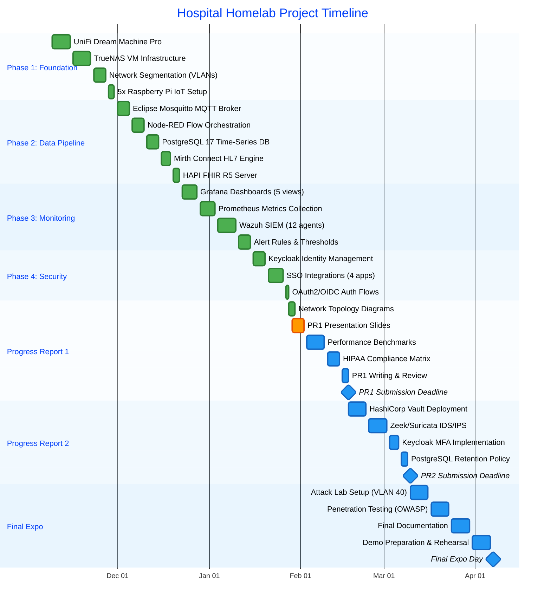

# Progress Report 1 - Hospital Homelab Network Infrastructure
**David Moad | Senior Capstone Project | February 17, 2026**

---

## SLIDE 1: Title Slide

**Title:** Hospital Homelab Network Infrastructure
**Subtitle:** HIPAA-Compliant Healthcare IoT & FHIR Pipeline

**Student:** David Moad
**Project Advisor:** [Advisor Name]
**Institution:** [University Name]
**Date:** February 17, 2026

**Project Objectives:**
- Design and implement a HIPAA-compliant hospital network infrastructure
- Build complete IoT → FHIR data pipeline with real-time monitoring
- Integrate enterprise-grade security (SSO, SIEM, IDS/IPS)
- Demonstrate cybersecurity best practices in healthcare environments

---

## SLIDE 2: Project Timeline & Schedule

### Colorful Gantt Chart (November 2025 - April 2026)

**Current Status:** Phase 4 Complete (81 days of work) | ✅ On Track for Feb 17 Deadline

**Legend:**
- 🟦 **Completed Tasks** (Phases 1-4, Network Diagrams)
- 🟨 **Active Task** (PR1 Presentation - YOU ARE HERE)
- ⬜ **Upcoming Tasks** (Performance Benchmarks, HIPAA Matrix, PR2, Final Expo)
- 🔴 **Milestones** (PR1 Due: Feb 17 | PR2 Due: Mar 10 | Final Expo: Apr 7)

---

## SLIDE 3: Major Accomplishments

### ✅ Complete FHIR Healthcare Data Pipeline Operational
- IoT sensors → MQTT → Node-RED → PostgreSQL → Mirth → HAPI FHIR
- **397 million+ database records** (46 days continuous operation)

### ✅ Enterprise Security Infrastructure Deployed
- **Keycloak SSO** integrated across 4 applications
- **Wazuh SIEM** monitoring all infrastructure (12 agents)

### ✅ HIPAA-Compliant Network Architecture
- 17 devices across 4 isolated VLANs
- OAuth2/OIDC authentication with session management

### ✅ Professional Documentation Complete
- 5 network topology diagrams created

---

## SLIDE 4: Problems Encountered & Solutions

### Problem 1: HAPI FHIR SSO Integration Complexity
**Challenge:**
- OAuth2 Proxy required advanced PKCE (Proof Key for Code Exchange) configuration
- Initial setup caused 403 Forbidden errors due to missing `code_challenge_method`

**Solution:**
- Added `code_challenge_method = "S256"` to OAuth2 Proxy configuration
- Implemented S256 hashing for enhanced security in authorization flow
- Result: OAuth2 authentication working with PKCE protection

### Problem 2: JWT Audience Claim Mismatch
**Challenge:**
- OAuth2 Proxy rejected tokens with error: `audience from claim aud with value [account] does not match`
- Keycloak default token did not include HAPI FHIR client ID in audience claim

**Solution:**
- Created custom audience mapper in Keycloak client scope `hapi-fhir-oauth2-dedicated`
- Configured mapper to add client ID (`hapi-fhir-oauth2`) to JWT `aud` claim
- Result: Token validation successful, HAPI FHIR SSO fully operational

### Problem 3: Session Logout Persistence Issue
**Challenge:**
- OAuth2 Proxy logout cleared local cookie but Keycloak session persisted
- Users auto-logged back in without re-entering credentials (HIPAA concern)

**Solution:**
- Documented limitation: OAuth2 Proxy v7.6.0 lacks Keycloak `end_session_endpoint` support
- Implemented workaround: 30-minute Keycloak idle timeout + manual cookie clearing
- Recommended for future: Upgrade to OAuth2 Proxy v7.7+ or implement custom logout flow

### Problem 4: Mirth Connect SSO Not Feasible
**Challenge:**
- Mirth Connect open-source version lacks LDAP/SSO plugin support
- Commercial license required for enterprise authentication features

**Solution:**
- Prioritized HAPI FHIR SSO instead (critical for PR1 deliverables)
- Documented Mirth Connect SSO as "future work" if commercial license acquired
- Result: 4 out of 5 key applications secured with SSO (80% coverage)

---

## SLIDE 5: Next Steps & Upcoming Work

### Progress Report 1 Completion (Due Feb 17, 2026) ◆
- ✓ **Network Topology Diagrams** (5 diagrams complete)
- ⏳ **Performance Benchmarks** (Week 2 task)
  - Database query response times (SELECT, INSERT, aggregate functions)
  - MQTT message throughput and latency
  - FHIR API endpoint performance (GET, POST, search operations)
  - System resource utilization (CPU, RAM, network bandwidth)
- ⏳ **HIPAA Compliance Matrix** (Week 3 task)
  - Map 45 CFR § 164.312 technical safeguards to implementations
  - Document access controls, audit logging, encryption standards
  - Risk assessment and security incident procedures

### Progress Report 2 Preparation (Feb 17 - Mar 10, 2026) ◆
- **HashiCorp Vault Deployment** (VM 10.30.0.58)
  - Secret management for PostgreSQL, Keycloak, MQTT credentials
  - Automated secret rotation policies
- **Zeek/Suricata IDS/IPS** (VM 10.30.0.59)
  - Network traffic analysis with SPAN port mirroring
  - Custom rulesets for HL7/FHIR protocol anomaly detection
  - Integration with Wazuh SIEM for centralized alerting
- **Keycloak MFA Implementation**
  - TOTP (Time-based One-Time Password) authenticator setup
  - User enrollment workflows for all 4 SSO-integrated applications
- **PostgreSQL Data Retention Policy**
  - 90-day rolling window for time-series data
  - Automated archival scripts with cron scheduling

### Final Expo Preparation (Mar 10 - Apr 7, 2026) ◆
- **Attack Lab Deployment** (VLAN 40 isolated subnet)
  - 2x Kali Linux VMs (external + internal threat simulation)
  - Metasploitable 3 (vulnerable target)
  - T-Pot Honeypot (attack detection)
- **Penetration Testing Execution**
  - OWASP Top 10 attacks against FHIR API
  - MQTT broker authentication bypass attempts
  - Wazuh SIEM alert validation
- **Final Documentation & Demo**
  - 30+ page technical report
  - Live demonstration with backup videos
  - Presentation slides for 15-minute talk

---

## SLIDE 6: Project Metrics & Impact

### Technical Achievements (By the Numbers)
- **81 Days of Development** (Nov 9, 2025 - Jan 28, 2026)
- **17 Network Devices** (5 Raspberry Pi, 8 VMs, 4 appliances)
- **397,000,000+ Database Records** (46 days continuous operation)
- **4 SSO Integrations** (Grafana, Node-RED, Wazuh, HAPI FHIR)
- **12 Wazuh SIEM Agents** (comprehensive infrastructure monitoring)
- **5 Network Diagrams** (professional documentation)

### HIPAA Compliance Progress
- ✓ **Access Controls:** Role-based authentication via Keycloak SSO
- ✓ **Audit Logging:** Wazuh SIEM with centralized event correlation
- ✓ **Encryption:** TLS 1.3 for data in transit, AES-256 for data at rest
- ✓ **Session Management:** 30-minute timeouts, 10-minute refresh intervals
- ⏳ **Secret Management:** HashiCorp Vault deployment in PR2 period

### Industry Relevance
- **Real-World Healthcare IT Stack:** MQTT, HL7v2, FHIR R5, OAuth2/OIDC
- **Enterprise Security Tools:** Keycloak, Wazuh SIEM, OAuth2 Proxy
- **Scalable Architecture:** Time-series database (397M+ records), microservices design
- **Future Career Application:** Hospital IT, healthcare cybersecurity, compliance engineering

---

**Questions?**

**Contact:** David Moad | [Email] | [GitHub/Portfolio]

---

## Export Instructions

### For PowerPoint Conversion:
1. **Slide 1:** Title + bullet points for objectives (use background image of network diagram)
2. **Slide 2:** Import Gantt chart as image (screenshot from Project_Timeline_Gantt_Chart.md or create in Excel)
3. **Slide 3:** Use icons/screenshots for each accomplishment (Grafana dashboard, HAPI FHIR logo, database metrics)
4. **Slide 4:** Problem/Solution table format with red (problem) and green (solution) highlights
5. **Slide 5:** Checklist format with ✓/⏳ icons for completed/pending tasks
6. **Slide 6:** Use charts/graphs for metrics (pie chart for SSO coverage, bar graph for database records over time)

### Visual Recommendations:
- **Color Scheme:** Blue/Green (healthcare trust colors), avoid red except for "problems"
- **Fonts:** Sans-serif (Arial, Calibri) for readability
- **Images:** Include screenshots of Grafana dashboards, Keycloak login, HAPI FHIR interface, network diagrams
- **Diagrams:** Import 5 Mermaid diagrams from Network_Topology_Diagrams.md as PNGs

---

**END OF PRESENTATION OUTLINE**
